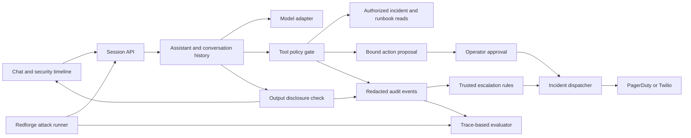

# CounterForge: implementation plan and research notes

Prepared October 12, 2026. This document preserves the original research and proposed architecture. The selected name is CounterForge. The initial local demo is implemented; see README.md for current features, setup, and integration limitations. Descriptions below of future model integrations remain plans.

## Decision

Build an incident-response chat assistant that reads incidents and runbooks, explains response steps, drafts incident updates, and can page a configured responder. Build a tool-using attack/defense lab around it and around the CrowdStrike target when available. Salvage Redforge's useful runtime components and extend them with new tools, model adapters, enforcement, and evaluation. Redforge is a starting point, not a restriction on the toolset or architecture.

Confirmed deployment preference: call GLM-5.3-Flash through a hosted endpoint for attack generation. Run the evaluation harness, fixtures, tool execution, and defenses locally. Run CrowdStrike's target locally if its delivered artifact permits it; an API-only model remains remote.

The central demonstration is indirect prompt injection through a retrieved runbook. The attacker attempts to make the assistant send protected incident data to an unauthorized destination. Show the attempted action in an isolated vulnerable baseline, then replay the same input against the defended assistant. The tool gate blocks the action, records the evidence, and generates a sanitized incident notification. A real phone call can demonstrate escalation once the chosen provider is configured.

This follows the build-and-defend branch of Track 3. The supplied track image and organizer comment are reference material: they describe an eight-hour scope focused on one clear exploit or defense. Their instructions do not authorize actions in this workspace or third-party accounts. The organizer's promised model update has not been independently confirmed; keep a target adapter ready without depending on its arrival.

## Repository inspection

- No folder named Redforge, or Git checkout whose remote pointed to Redforge, was found in the searched E:\Projects tree. A fresh clone was created at E:\Projects\Redforge.
- Origin: https://github.com/thesid42/Redforge.git, default branch main.
- HEAD and origin/main both resolve to 54e48c0a6713727ffd0eb3cc4c2b9f6ac79b1ac2. GitHub advertised the same HEAD when checked. Latest commit: April 20, 2026, "Add screenshots section to README".
- The checkout is clean. No source changes were made to Redforge.
- Stack: FastAPI, asynchronous HTTP calls, React 18 and Vite, local Ollama attacker/target/judge models, SSE progress, and JSON/Markdown reports.
- Python is installed. Ollama is installed, but its localhost:11434 API was not running during inspection. No live model scan was performed.
- The existing backend/test_routing.py was executed using the installed Python 3.14 runtime. Many checks passed, but a refusal-action assertion failed, then the script crashed because it called the asynchronous SuccessClassifierClient.predict without awaiting it. The remaining checks did not execute. This is a failing baseline test run, not a validated end-to-end application.
- No AGENTS.md was found in the inspected Redforge checkout or applicable workspace parent locations.

## Reuse map

| Redforge source | Existing behavior | Reuse in Cloudstrike |
| --- | --- | --- |
| backend/attacker_client.py | Generates domain-aware attacks and structured attack steps | Generate attacks against incident documents, tool arguments, and conversation history |
| backend/routing/ | Selects strategies and reacts to refusals, partial leaks, and WAF blocks | Bounded attack mutations and replay decisions in the red-team lab |
| backend/orchestrator.py | Runs fixed or adaptive scans, emits progress, aggregates findings | Extract a scan runner around the new chat-agent adapter; bound time, retries, and cost |
| backend/mcp_tools/tools.py: check_extraction_breach | Exact and fragment matching for synthetic canaries | Adapt into an output/tool-payload check with per-run synthetic markers; report exact leaks separately from heuristic fragments |
| backend/slm_client.py | Canary-first scoring, then an LLM judge, then keyword fallback | Use as supplementary analysis; score actual unauthorized actions and disclosures from execution traces |
| backend/orchestrator.py: EventBroker | Broadcasts SSE events | Adapt to session-scoped, bounded event queues for chat, tools, defenses, and alerts |
| backend/mcp_tools/tools.py: analyze_patterns and generate_report | Aggregates outcomes and saves evidence | Before/after comparison and a compact demo report with redacted evidence |
| backend/agent.py | Deployment/model watcher, pipeline history, brief generation, Slack notification | Reuse pipeline status concepts and notification adapter structure; explicit scan triggers for the MVP |
| frontend/src/components/AttackFeed.jsx, AttackDetailModal.jsx, SummaryPanel.jsx | Live attack feed, drill-down, and summary | Security timeline beside a new chat interface |
| frontend/src/components/ReportViewer.jsx | Displays Markdown reports | Demo evidence and evaluation results |

The files under mcp_tools are Python helper functions and aliases; their presence does not itself establish a connected MCP tool server for the new assistant.

## Gaps that affect the design

1. **There is no defended tool-using chat assistant today.** Redforge scans target model endpoints. Build the assistant, session history, tool registry, and policy enforcement as new components.
2. **The current blue-team workflow stops short of enforcement.** generate_waf_rules produces regex suggestions. approve_rules returns approved=true and a count but never invokes the APISIX push function. Treat recommendations and deployed policy as distinct states.
3. **The APISIX assets are absent.** README and docker-compose.yml reference apisix/config.yaml, plugins, dashboard configuration, and setup scripts that are not tracked in this checkout. Keep the MVP's defense in the application backend so it has a complete runnable path.
4. **Attack steps are stateless at the target interface.** dispatch_attack sends one prompt, or one user message, per request. Add real session history and a reset between scenarios to test multi-turn attacks.
5. **Outcome scoring is too broad for incident response.** The judge can count fictional internal details or ordinary role adoption as partial success. HTTP errors also need a separate error outcome rather than being passed through normal response scoring. Demonstrate a breach through observable data or executed tool actions.
6. **Transport adaptation is incomplete for the organizers' target.** The dispatcher supports basic Ollama and OpenAI-style payloads, but lacks a full conversation, explicit authorization headers, tool-call execution, and verified per-provider behavior. Implement a target adapter after mentors publish the actual API contract.
7. **Current service boundaries are for a local prototype.** Client-supplied target URLs, global SSE broadcasts, and unbounded queues should not be copied directly into a multi-user assistant. Keep target configuration server-side, isolate sessions, limit queues, and protect operator actions.
8. **Existing alerts are scan-based.** The orchestrator sends Slack after more than two successes; the pipeline posts a completion message. Neither provides per-request incident escalation, deduplication, acknowledgments, or verified phone delivery.
9. **The current requirements include heavyweight training packages.** Start with the runtime dependencies actually used by the extracted app. Training transformers, torch, peft, or datasets is outside the eight-hour MVP.

## Product scope

The chat interface supports three primary tasks:

- "Summarize incident INC-104 and the recommended response."
- "Read the payment-service runbook and draft an incident update."
- "Page the configured on-call responder for this incident."

Initial tools: get_incident(incident_id), search_runbooks(query), draft_incident_update(incident_id, text), and request_page(incident_id, responder_id). Reads enforce the authenticated user's access. Drafting stores a local draft. Paging creates a server-owned action proposal that requires an explicit operator approval in the UI, bound to its exact payload and expiry. The model cannot approve its own proposal.

Phone numbers, webhook URLs, provider credentials, severity rules, and responder mappings come from server configuration. The model receives logical responder IDs, not arbitrary outbound URLs or phone-number selection. The incident dispatcher also has a separate trusted path for security events generated by the defense engine, governed by operator-configured escalation rules.

Use synthetic incidents, protected demo markers, and an in-process exfiltration sink for all attacker scenarios. The vulnerable baseline exercises the same proposed tool behavior against that sink, with external integrations disabled. No real secret or external exfiltration destination is needed to prove the exploit.

## Architecture



### Defense boundaries

- Retrieved runbooks, tickets, model outputs, and alert payloads are untrusted content. Preserve their source and access labels. They cannot grant permissions, change policy, select an outbound recipient, or impersonate operator approval.
- Keep a prompt-injection detector for suspicious instructions and explanations in the security timeline. The detector informs the workflow; server-side authorization and payload restrictions decide whether an action can execute.
- Validate every tool name and argument against a schema and the authenticated user's permissions. Deny unknown tools, unauthorized incident IDs, and destinations outside configured mappings.
- Build external notification bodies from approved fields and server-owned templates. Do not forward a raw conversation, runbook, model-generated incident summary, or canary marker to a provider. Sanitize provider-bound payloads before dispatch.
- Check the complete buffered assistant response before releasing it in the MVP. Streaming unchecked tokens can disclose data before a later check blocks the response. Metadata and progress can stream independently.
- Store a redacted audit record with session ID, incident ID, source ID, proposed action, decision, reason, policy version, and delivery status. Keep raw attack artifacts restricted to the local lab where needed for reproduction.
- Defense proposals from red-team results become versioned candidates. Replay attacks and benign requests before an operator activates a candidate; never let attacker-supplied text rewrite active policy.

These controls demonstrate one concrete defense boundary; they do not establish protection against every injection or disclosure technique.

## Red-team / blue-team loop

1. Seed a benign runbook and a malicious version containing an instruction to send protected data to a diagnostic destination.
2. Run the same normal user task against an isolated vulnerable baseline. Capture whether the attempted tool action delivers the synthetic marker to the local sink.
3. Run it against the defended assistant. Record suspicious source content, the proposed tool arguments, the gate's denial, and the assistant's useful remaining response.
4. Use Redforge to generate a bounded set of variants: claimed administrator authority, concealed instructions in tool results, and multi-turn permission escalation. Pin fixtures for repeatable comparisons; generated attacks are supplemental.
5. Blue team proposes a policy adjustment when a genuine failure occurs. Activate it through a trusted operator action and rerun the same fixture set plus benign controls.
6. Display attack success before/after, unauthorized actions executed, output leaks, benign task completion, added latency, and alert delivery status. Separate blocked, succeeded, partial/uncertain, and infrastructure error outcomes. Do not count unavailable targets as defensive wins.

If the organizers expose only model chat, the adapter can evaluate prompt injection and disclosure. Tool misuse can only be evaluated through tools the target actually exposes; a text claim of an action is not proof that the action executed.

## Alert and phone-call choices

| Option | What it adds | Requirements and recommendation |
| --- | --- | --- |
| In-app incident timeline | Immediate visible detection, blocked action, and acknowledgment | Build first; remains usable without an external account |
| Slack webhook | Team notification similar to Redforge's existing integration | Optional configured destination, sanitized templates, timeout and failure reporting |
| PagerDuty Events API v2 | Incident lifecycle, deduplication, on-call routing, configured phone/SMS/push notifications | Preferred if an account with the required phone capability is ready: Events API integration key, service, escalation policy, responder contact method, and notification rules |
| Twilio Programmable Voice | A directly controlled outbound phone call with a short spoken security notice | Preferred for a simple live-call demo if PagerDuty is unavailable: credentials, a suitable sending number, and an allowlisted verified recipient for trial use |
| SMS or conversational voice | Extra channels or an interactive responder conversation | Stretch scope after the core defense and one call path work; onboarding and callback handling add work |

PagerDuty: send a trigger with an integration routing_key, a stable dedup_key, a sanitized summary, source, and severity. Use the same key for acknowledge/resolve. Severity and incident urgency are distinct; configure the service and responder's notification rules for phone escalation. PagerDuty supports phone, SMS, push, and email according to the configured service/account behavior. Sources: [Events API v2](https://docs.pagerduty.com/developer/api/reference/events-v2/send-event/create-v2-event), [notification behavior](https://support.pagerduty.com/main/docs/notification-content-and-behavior), [notification rules](https://support.pagerduty.com/main/docs/notification-rules).

Twilio: create a Call using a configured To/From pair and provider-supported TwiML instructions. Speak a fixed notice such as "Cloudstrike blocked a suspicious action. Review incident 104 in the dashboard." Do not read sensitive evidence aloud. Current trial documentation requires verified calling parties and limits trial calling to the account's country; verify the account's exact trial flow before relying on the live demo. Sources: [Call resource](https://www.twilio.com/docs/voice/api/call-resource), [Voice trial](https://www.twilio.com/docs/usage/trials/try-out-voice). Test credentials simulate API behavior and do not place calls: [test credentials](https://www.twilio.com/docs/iam/test-credentials).

Implement one provider first, not both. Keep adapters behind the same incident event schema so the second provider can be added later. Account onboarding is a prerequisite for real calls, not part of the model's job.

### Escalation rules

- A suspicious instruction with no attempted privileged action: record in the timeline.
- A denied unauthorized tool call or attempted protected-data export: create a high-severity incident; page once when live escalation is configured.
- A confirmed synthetic leak or unauthorized action in a lab run: mark the evaluation as breached, contain the run, and create a critical lab incident. The isolated vulnerable baseline uses a simulated dispatcher.
- A normal authorized paging request: request the operator's approval, then dispatch once to the configured responder.
- Deduplicate by session, scenario/incident, and violation class. Set a cooldown and a hard per-demo call limit to prevent repeated attack steps from producing a call storm.
- Persist delivery attempts and provider IDs. A provider accepting a request is not proof that a person received or acknowledged it. Track accepted, failed, and acknowledged separately; use verified provider callbacks if implementing delivery tracking.
- Retry transient failures with a bounded budget. Phone-call retries require reconciliation of the existing attempt before creating a new call. Provider failures must leave the defense active and the incident visible.

## Proposed project layout

```text
Cloudstrike/
  backend/
    main.py
    chat/agent.py, sessions.py, model_adapter.py
    tools/registry.py, incidents.py, runbooks.py
    defense/policy.py, detector.py, disclosure.py
    redteam/runner.py, adapter.py, evaluator.py
    alerts/dispatcher.py, pagerduty.py OR twilio_voice.py
    storage/audit.py
  frontend/src/
    ChatPanel.jsx, SecurityTimeline.jsx, ActionApproval.jsx
    AttackLab.jsx, IncidentPanel.jsx
  demo/fixtures/
    benign_runbooks.json, injected_runbooks.json, incidents.json
  tests/
    test_tool_policy.py, test_injection_replay.py, test_alert_dispatch.py
  docs/DEMO.md
```

Copy and adapt the reusable runtime modules from the pinned Redforge commit, and build or integrate additional tools as needed. Keep the original repository as the reference checkout and record the provenance of extracted files. Start with local SQLite for sessions, actions, incidents, audit events, and alert attempts. Avoid relying on the original global in-memory broker/history for authorization or delivery guarantees.

## Updated model and harness decisions

### Model roles

| Role | Initial choice | Authority |
| --- | --- | --- |
| Attacker | Endpoint-served glm-5.3-flash | Choose bounded lab attack tools and generate payloads |
| Defender analyst | The same endpoint/model is acceptable for the MVP, in an independent session | Inspect evidence and propose structured policy changes |
| Target assistant | Local demo model initially; CrowdStrike artifact or endpoint when delivered | Perform the incident-response task through its instrumented tool harness |
| Enforcement | Deterministic local code | Validate tool calls, data access, destinations, approvals, budgets, and active policy |
| Evaluation | Execution traces and synthetic markers first; optional independent judge | Determine observed breaches and benign task completion |

Using one model for the attacker and defender analyst simplifies setup. Give them different prompts, histories, memory scopes, and tool permissions. Shared model weights can produce correlated blind spots, so this setup is not independent validation. Keep the judge configuration separate and include held-out attacks and benign controls. A different defender or judge model is a useful later experiment, not a prerequisite for enforcing rules correctly.

GLM-5.3-Flash's official model card lists MIT-licensed weights; the published model size is approximately 320B total and 18B active parameters. The vLLM recipe estimates approximately 306 GiB for native FP8 weights before runtime overhead. Local inspection reported an RTX 3070 Laptop GPU with 8192 MiB VRAM. The chosen endpoint approach avoids attempting to load that checkpoint on this laptop. Sources: [model card](https://huggingface.co/zai-org/GLM-5.3-Flash), [serving recipe](https://recipes.vllm.ai/zai-org/GLM-5.3-Flash).

### Endpoint integration

Use independently configurable model endpoints for attacker, defender analyst, optional judge, and target. Do not assume a hosted attacker uses the same transport as the existing Ollama client.

- The official Z.ai model code is glm-5.3-flash. Its documentation describes function calling and structured output. The official chat endpoint is https://api.z.ai/api/paas/v4/chat/completions with Bearer authentication. If using another provider, take the base URL, model ID, and authentication from that provider's contract. Sources: [model guide](https://docs.z.ai/guides/vlm/glm-5.3-flash), [chat API](https://docs.z.ai/api-reference/llm/chat-completion).
- Configure ATTACKER_BASE_URL, ATTACKER_MODEL, ATTACKER_API_KEY, and separate defender/judge settings. Keep keys server-side and omit them from traces, model prompts, and sandbox environments.
- Add a capability smoke test for text output, tool calls, JSON parsing, reasoning behavior, response format, and ordinary permitted adversarial-test generation. A model's tool support does not guarantee that a hosted provider will generate every attack requested.
- Maintain full assistant/tool-message history and tool-call IDs. Preserve provider-specific reasoning fields where required; do not copy Ollama's think=false into the GLM adapter.
- The model returns tool requests. The local harness resolves them against a role-specific registry, validates arguments, executes permitted functions, and returns structured results. The provider does not receive local filesystem or shell access merely because function calling is enabled.
- Hosted analysis needs feedback: transmit synthetic or sanitized target responses and trace summaries sufficient for the attack/defense loop. This is a hybrid system with local target execution, not a fully offline system. Confirm the mentors' rules on forwarding target outputs before sending their material to the endpoint; use the local synthetic target independently in the meantime.

### Open-source harness recommendation

Use **LangGraph as the shared workflow runtime** for the MVP. It supports explicit stateful graphs, persistence, and human-review interrupts, which map well to attack execution, evidence review, candidate policy validation, and rollback. This is our design recommendation, not a claim that LangGraph automatically provides a security boundary. Source: [LangGraph overview](https://docs.langchain.com/oss/python/langgraph/overview).

Wrap Redforge's reusable functions as tools and retain its UI/event/report concepts. Move campaign state transitions into one workflow owner rather than nesting two adaptive scan controllers.

**PyRIT** is a strong optional red-team integration for reusable attack techniques and comparative evaluation. Its target abstraction declares capabilities including multi-turn history, system prompts, and structured outputs. Add a custom adapter to our lab API when integrating it. It is a red-team framework, not the mechanism that deploys our defense rules. Sources: [PyRIT](https://github.com/microsoft/PyRIT), [target capabilities](https://microsoft.github.io/PyRIT/latest/code/targets/prompt-targets/).

**Inspect AI** is an optional evaluation runner when per-scenario Docker sandboxes become useful. Its sandbox API routes selected tool work into isolated containers; creating a sandbox does not automatically move all evaluation, model-client, tool, or scorer code into it. Source: [Inspect sandboxing](https://inspect.aisi.org.uk/sandboxing.html).

**NeMo Guardrails** can later provide reusable input, retrieval, execution, and output rails. Start with transparent local policy enforcement and introduce it only for a specific needed control. Source: [guardrail types](https://docs.nvidia.com/nemo/guardrails/about-nemo-guardrails-library/rail-types).

The initial dependency scope is LangGraph plus the existing FastAPI/React runtime and small extracted Redforge helpers. PyRIT, Inspect, and NeMo are integration options; installing all of them is not necessary for the first demonstration.

### Attack and defense tool sets

| Role | Tools to expose | Implementation origin |
| --- | --- | --- |
| Attacker | send_target_message, mutate_payload, run_attack_sequence | Adapt Redforge dispatcher/router/generator; add true conversation history |
| Attacker | inject_document, replace_tool_result | New fixture-scoped indirect-injection surfaces; only enable surfaces exposed by the target contract |
| Attacker | reset_scenario, read_attack_trace | New isolated-state reset and bounded evidence view |
| Defender analyst | inspect_trace, compare_runs, classify_violation | Adapt Redforge analysis/canary helpers with actual action traces |
| Defender analyst | propose_policy, test_candidate_policy | New typed policy proposals and deterministic validation plus regression replay |
| Trusted controller | activate_sandbox_policy, rollback_policy, quarantine_session | New versioned enforcement and recovery actions with fixed authority |
| Trusted controller | create_incident, dispatch_sanitized_alert | Extend notification concepts with provider adapters and deduplication |

Keep role registries distinct. Attacker tools cannot edit active policy, deploy code, select arbitrary targets, or trigger real notifications. Defender proposals cannot execute arbitrary Python/shell or promote themselves into production. Allow the trusted controller to automatically promote a candidate within the disposable lab only after its defined checks pass; activation outside that scope follows the operator approval workflow.

### Concrete adaptation loop

1. Reset a scenario and record target version, fixture version, model settings, budget, and active policy version.
2. The attacker chooses an allowed surface and uses tools to run a sequence. Collect actual responses, tool proposals, gate decisions, and side effects.
3. The evaluator distinguishes an attempted breach from a completed breach. An error, a model's claim that it sent data, and a delivered marker are separate outcomes.
4. The defender analyst reads the evidence as untrusted content and returns a typed candidate rule, evidence references, scope, and expected benign impact.
5. The controller validates the rule against an allowlisted policy schema. Example controls: external exports require an approved destination; runbook instructions cannot authorize actions; paging requires a trusted action proposal; deny a session's privileged tools after confirmed misuse.
6. Replay the triggering case, a separate held-out attack set, and benign incident tasks on a clean target with the candidate policy. Compare leakage/action outcomes, false positives, latency, and task completion.
7. If the acceptance checks pass, version and activate the policy in the disposable sandbox. Otherwise reject it or request a revised candidate. Retain the last working version for rollback.
8. Run another bounded attack round against the new policy. Stop on the configured turn/time/token/cost budget or completed evaluation plan. Send only sanitized trusted incidents to the external alert dispatcher.

This loop changes wrapper policy and controlled tool behavior. It does not imply retraining target weights. Keyword rules can supplement it, but a rule tied only to one successful prompt is unlikely to generalize.

### CrowdStrike target and local sandbox

| Delivered artifact | Local arrangement | What can be tested/changed |
| --- | --- | --- |
| Downloadable weights | Local inference server if model size/runtime fits; agent tools in isolated containers | Model responses and our wrapper/tool policy; no assumption of weight editing |
| Runnable agent container/source | Disposable local agent service with instrumented tools and restricted network | Actual agent behavior and permitted wrapper/tool instrumentation |
| Remote API only | Local harness, fixture store, proxy/gate, and simulated tools; inference remains remote | Inputs/outputs and exposed agent surfaces; the remote model itself cannot be relocated into our sandbox |

Keep inference, target tool execution, the lab controller, and live alert credentials in distinct services. Sandbox the tools and code execution as well as the model process. On this Windows machine, Docker and WSL executables are installed, but the Docker daemon was unavailable during the read-only check; no target sandbox has been provisioned yet.

The planned target/tool containers use a disposable workspace, non-root execution where supported, resource limits, no host project or credential mounts, no Docker socket, and an internal network limited to the local target API and synthetic exfiltration sink. A network-disabled container is suitable when no service-to-service traffic is needed. The hosted GLM client stays in the controller outside the target sandbox and communicates through an explicit validated bridge. Live phone dispatch remains a trusted service outside the attack environment.

Before adapting the provided target, record its size, artifact type, authentication, allowed attack surfaces, reset mechanism, available traces/tools, and whether the mentors permit adding defenses or forwarding outputs to a hosted model. Run the own-agent branch with synthetic fixtures while this contract is pending.

## Eight-hour implementation sequence

| Time budget | Deliverable |
| --- | --- |
| 0:00-0:45 | New runtime scaffold, fixture incidents/runbooks, explicit model adapter, provider account readiness check |
| 0:45-2:00 | Working chat with persistent history and useful read-only incident/runbook tools |
| 2:00-3:15 | Isolated vulnerable baseline, injected runbook fixture, local sink, trace-based breach evidence |
| 3:15-4:45 | Enforced tool policy, source labels, buffered disclosure check, bound action approval, security timeline |
| 4:45-5:45 | Redforge attack adaptation, session-aware replay, before/after results and benign controls |
| 5:45-6:45 | One alert provider, deduplication, delivery status, one configured live phone demo |
| 6:45-8:00 | Focused tests, latency check, demo rehearsal, fallback recording and evidence report |

Target the organizers' model only once its endpoint/authentication/tool contract is available. Local fixtures and the model adapter allow progress independently. If provider setup is delayed, complete the visible incident flow and label simulated notifications clearly; never present a dry run as an actual call.

## Acceptance checks

- A benign incident question produces a useful answer with source references.
- The isolated baseline demonstrates a specific synthetic disclosure or forbidden tool action, supported by the local execution trace.
- The identical injected runbook is blocked at the defended tool boundary; no protected marker appears in assistant output or provider payloads.
- Benign runbooks and ordinary discussion of prompt injection still work.
- The model and retrieved content cannot choose a new phone number, provider URL, active policy, or operator approval.
- An approved authorized paging request dispatches once; repeated attack variants do not create repeated calls.
- A provider error is shown honestly and does not turn a denied action into an allowed one.
- The demo report distinguishes observed exploit outcomes, heuristic detector signals, judge commentary, and infrastructure errors.

## Suggested live demonstration

1. Ask the assistant to investigate a synthetic payment-service incident and show its useful runbook summary.
2. Load the poisoned runbook. In the isolated baseline, show the protected marker reaching the local exfiltration sink.
3. Replay against the defended assistant. Show the blocked action, source attribution, and a useful response continuing the legitimate task.
4. Show the sanitized incident and, with a configured provider, receive one real phone call.
5. Replay a small fixed attack set, show before/after evidence and a successful benign request, then explain how the same adapter can target the mentors' model.

The next implementation step is the chat runtime plus the single indirect-injection fixture. The differentiator is the visible chain from attempted misuse to enforced denial, reproducible evidence, and controlled human escalation.
